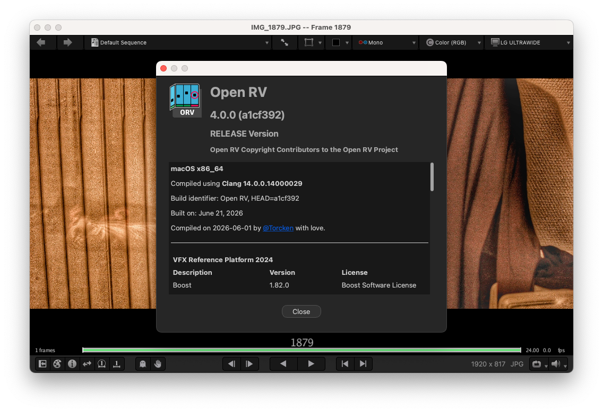
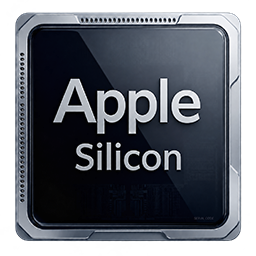
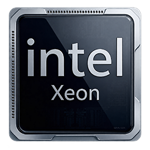
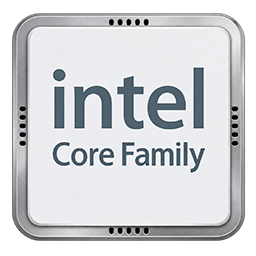

# OpenRV — Open Builds

<p align="center">
  <strong>OpenRV, ready for your next review.</strong><br>
  Personal builds for Linux, Apple Silicon & Intel Macs.
</p>


<p align="center">
  <a href="https://github.com/Torcken/OpenRV---open-builds/releases"></a>
  <a href="#download"></a>
  <a href="#download"></a>
</p>

<p align="center">
  <a href="https://github.com/Torcken/OpenRV---open-builds/releases"><strong>Download builds</strong></a>
  &nbsp;·&nbsp; <a href="#install">Installation</a>
  &nbsp;·&nbsp; <a href="https://aswf-openrv.readthedocs.io/">OpenRV documentation</a>
  &nbsp;·&nbsp; <a href="#support">Support</a>
</p>
[OpenRV](https://github.com/AcademySoftwareFoundation/OpenRV) is a hardware-accelerated image and sequence viewer for VFX and animation artists. These are my personal builds, packaged and shared so you can get started without compiling OpenRV yourself.



<p align="center">
  
  &nbsp;&nbsp;
  
  &nbsp;&nbsp;
  
</p>


## Download

**Three builds, available through [GitHub Releases](https://github.com/Torcken/OpenRV---open-builds/releases).**
Open a release and expand **Assets** to choose your package.

| Your computer | Choose | Format |
| --- | --- | --- |
| Linux PC with an Intel or AMD 64-bit processor | Linux **x86_64** | AppImage |
| Mac with Apple Silicon, including M-series chips | macOS **arm64** | DMG |
| Mac with an Intel processor | macOS **x86_64** | DMG |

For Apple Silicon, choose the native **arm64** build. Rosetta 2 is only needed if you choose to run the Intel build on an Apple Silicon Mac.

Check each release's notes for its OpenRV version, build date, operating-system requirements, and signing status. Download the matching `.sha256` file alongside your macOS DMG.

## Built for looking closer

OpenRV brings image review into the workflows artists use every day:

- **Review sequences, movies, and audio.** Load, play, inspect, and navigate your material in one viewer.
- **Work with hardware-accelerated playback.** Use a viewer designed for VFX and animation review.
- **Make it part of your pipeline.** Explore keyboard shortcuts, command-line controls, and customization in the [OpenRV documentation](https://aswf-openrv.readthedocs.io/).

This repository provides the packaged downloads. OpenRV's source code and
development live in the [upstream project](https://github.com/AcademySoftwareFoundation/OpenRV).

## Install

### macOS

1. Download the **arm64** DMG for Apple Silicon or the **x86_64** DMG for Intel,
   plus its matching `.sha256` file.
2. [Verify the checksum](#verify-your-download) before opening the disk image.
3. Open the DMG and drag **RV.app** into **Applications**.
4. Launch **RV** from Applications.

Signing and notarization status are specific to each release. macOS may display
a security warning for an unnotarized package; review the release's signing
information before proceeding.

For build-machine details and installed-app validation commands, see the
[macOS guide](macOS/README_mac.MD).

### Linux

Download `OpenRV-x86_64.AppImage`. Open a terminal in the download folder, then run:

```bash
chmod +x OpenRV-x86_64.AppImage
./OpenRV-x86_64.AppImage
```

Linux compatibility depends on your distribution, system libraries, and graphics
drivers. Refer to the release notes for the environment used to build and test
the package.

## Verify your download

The macOS packages include SHA-256 checksum files. In the download folder, run
the commands for your architecture and compare the two 64-character digests.
They must match.

<details>
<summary><strong>Apple Silicon — arm64</strong></summary>

```bash
shasum -a 256 OpenRV-macOS-arm64-unofficial.dmg
cat OpenRV-macOS-arm64-unofficial.dmg.sha256
```

</details>

<details>
<summary><strong>Intel — x86_64</strong></summary>

```bash
shasum -a 256 OpenRV-macos-x86_64-unofficial-.dmg
cat OpenRV-macos-x86_64-unofficial-.dmg.sha256
```

</details>

The current checksum files contain paths from the build machine. Compare the
digests directly; `shasum -c` will not work with those paths in your download folder.

## Support

Found a download, installation, or packaging issue?
[Open an issue here](https://github.com/Torcken/OpenRV---open-builds/issues) with the package filename, your operating system and processor architecture,
steps to reproduce, and any error message. Screenshots help when the issue is visual.

For OpenRV usage, start with the [official documentation](https://aswf-openrv.readthedocs.io/). If a bug also reproduces in an upstream build, report it to the [OpenRV project](https://github.com/AcademySoftwareFoundation/OpenRV/issues).
Code contributions belong upstream; improvements to these packages and guides are welcome here.

## About these builds

Compiled and shared by [@Torcken](https://github.com/Torcken) with love ♡. 
These personal, unofficial builds are provided as-is, independently of the Academy Software Foundation, Autodesk, and the OpenRV maintainers. They are not affiliated with,
endorsed by, or supported by those organizations or maintainers.

OpenRV is licensed under [Apache 2.0](https://github.com/AcademySoftwareFoundation/OpenRV/blob/main/LICENSE). Upstream copyright, license, and third-party notices remain applicable and must be preserved when redistributing packages.

Thank you to the OpenRV developers and contributors for making the viewer available.
